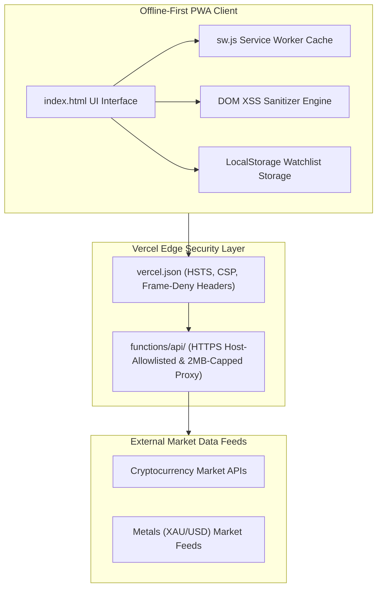

# Cyphr Toolkit

> Open-source W.D. Gann mathematical market geometry (Square of 9, time-price cycle harmonics) & real-time crypto/metals analytics PWA.

[](actions/workflows/ci.yml) | [](actions/workflows/codeql.yml) | **[License: MIT](LICENSE)** | **[Live Demo: cyphr-toolkit.vercel.app](https://cyphr-toolkit.vercel.app)** | **[PWA Ready](manifest.webmanifest)** | **[Security Policy](SECURITY.md)** | **[PRs Welcome](CONTRIBUTING.md)**

---

## Overview & Ecosystem Gap

In retail and quantitative technical analysis, non-linear market geometry tools—such as W.D. Gann Square of 9, cardinal and ordinal degree grids, price-time cycle harmonics, and cycle confluences—are traditionally locked behind expensive proprietary desktop terminals or closed-source scripts. Independent traders, quantitative analysts, students, and developers often lack access to a transparent, auditable reference implementation.

Cyphr Toolkit solves this ecosystem gap by providing a fully open-source, zero-dependency, browser-native reference implementation. All calculations execute transparently on the client side without black-box logic or proprietary software lock-in.

---

## System & Security Architecture Diagram



---

## Core Capabilities

- **W.D. Gann & Cycle Harmonics Engine:** Square of 9 degree/angle projections, cardinal and ordinal cross levels, and time-price cycle confluence calculators.
- **Market Data Aggregation:** Real-time and historical cryptocurrency and metals (XAUUSD) price feeds and cycle analysis.
- **Zero-Dependency Offline-First PWA:** Built with vanilla JavaScript and HTML (`sw.js`, `manifest.webmanifest`) with zero client-side framework bloat, local-storage watchlists, and markdown/JSON note exports.
- **Hardened Serverless Proxy Layer:** Edge/serverless proxy endpoints (`functions/api/`) for Vercel and Netlify (`netlify/functions/api.js`) with host allowlisting and request payload limits (2MB).

---

## Enterprise Security Architecture & Defense-in-Depth

Security is integrated natively into every architectural layer of Cyphr Toolkit:

- **Automated SAST Scanning:** Integrated GitHub [CodeQL SAST Workflow](.github/workflows/codeql.yml) running on `push`, `pull_request`, and weekly cron schedules to detect security vulnerabilities and static bugs.
- **Automated Dependency Management:** Automated updates via GitHub [Dependabot Configuration](.github/dependabot.yml) monitoring GitHub Actions ecosystem dependencies weekly.
- **Code Ownership & Guardrails:** Explicit code ownership defined in [.github/CODEOWNERS](.github/CODEOWNERS) assigning core repository paths (`*`, `/.github/`, `/functions/`) to maintainer `@h7nnn`.
- **RFC 9116 Security Manifest:** Publicly disclosed security metadata at [.well-known/security.txt](.well-known/security.txt) standardizing vulnerability report procedures.
- **Enterprise HTTP Security Headers:** Strict global HTTP header enforcement in [vercel.json](vercel.json) including HSTS (`Strict-Transport-Security: max-age=63072000; includeSubDomains; preload`), `X-Frame-Options: DENY`, `X-Content-Type-Options: nosniff`, `Referrer-Policy: strict-origin-when-cross-origin`, and restrictive `Permissions-Policy`.
- **Client-Side Data Isolation & Sanitization:** Zero external tracking, client-side DOM XSS sanitization, and strict input validation.

---

## Repository Structure

```
.
├── .github/
│   ├── CODEOWNERS              # Code ownership declarations
│   ├── dependabot.yml          # Dependabot automation rules
│   └── workflows/              # GitHub Actions CI & CodeQL SAST workflows
├── .well-known/
│   └── security.txt            # RFC 9116 security contact manifest
├── functions/                  # Vercel serverless proxy functions
├── index.html                  # Core PWA application layout & engine
├── manifest.webmanifest        # PWA application manifest
├── sw.js                       # Offline service worker cache engine
└── vercel.json                 # Enterprise HTTP security header rules
```

---
## STRIDE Threat Model Matrix
| STRIDE Category | Threat Vector | Defense-in-Depth Mitigation | Enforced In |
| --- | --- | --- | --- |
| **S — Spoofing** | Cross-origin framing & clickjacking | `X-Frame-Options: DENY` and `Content-Security-Policy: frame-ancestors 'none'` | `vercel` config |
 **T — Tampering** | Multi-pass HTML/CDATA & DOM XSS injection | Iterative `do...while` tag scrubber & backslash/quote escaping | `index` UI & API functions |
| **R — Repudiation** | Unreviewed workflow or proxy changes | Enforced `@h7nnn` code ownership & SHA-pinned CI audit logs | `CODEOWNERS` & `ci` workflow |
| **I — Information Disclosure** | Credential leakage or cross-origin window leaks | GitHub Secret Scanning + Push Protection, `Cross-Origin-Opener-Policy: same-origin`, `Referrer-Policy` | Repo Settings & `vercel` config |
| **D — Denial of Service** | Oversized upstream payloads & unauthenticated alert floods | Strict 2 MB payload ceiling, timeout guards, and gated notification endpoints | Serverless API proxies |
| **E — Elevation of Privilege** | SSRF & CI token abuse | Strict HTTPS-only host allowlisting, top-level `permissions: {}`, and 40-char SHA-pinned Actions | Serverless API & GitHub Actions |
---
## Edge Security & Proxy Configuration Reference
| Control / Parameter | Configured Value | Security Purpose |
| --- | --- | --- |
| `Strict-Transport-Security` | `max-age=63072000; includeSubDomains; preload` | Enforces HTTPS connections across subdomains with HSTS preload listing |
| `Content-Security-Policy` | `frame-ancestors 'none'; base-uri 'self'; form-action 'self'; upgrade-insecure-requests` | Prevents framing, base tag injection, form hijacking, and upgrades insecure requests |
| `X-Content-Type-Options` | `nosniff` | Prevents MIME-type sniffing by forcing browser to adhere to declared content types |
| `Cross-Origin-Opener-Policy` | `same-origin` | Isolates top-level browsing context to protect against cross-origin window leaks |
| `Permissions-Policy` | `camera=(), microphone=(), geolocation=()` | Disables risky browser features and hardware APIs for origin security |
| `MAX_PAYLOAD_BYTES` | `2,097,152 bytes / 2 MB` | Limits maximum request body payload size to mitigate denial-of-service floods |
| `ALLOWED_PROTOCOLS` | `HTTPS only + strict upstream host allowlist` | Restricts proxy targets to secure HTTPS endpoints and allowed hosts |
---

## License

Distributed under the MIT License. See [LICENSE](LICENSE) for details.
